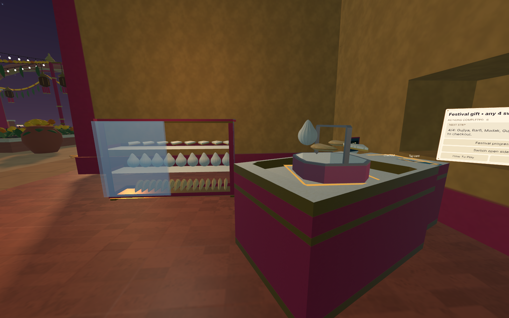
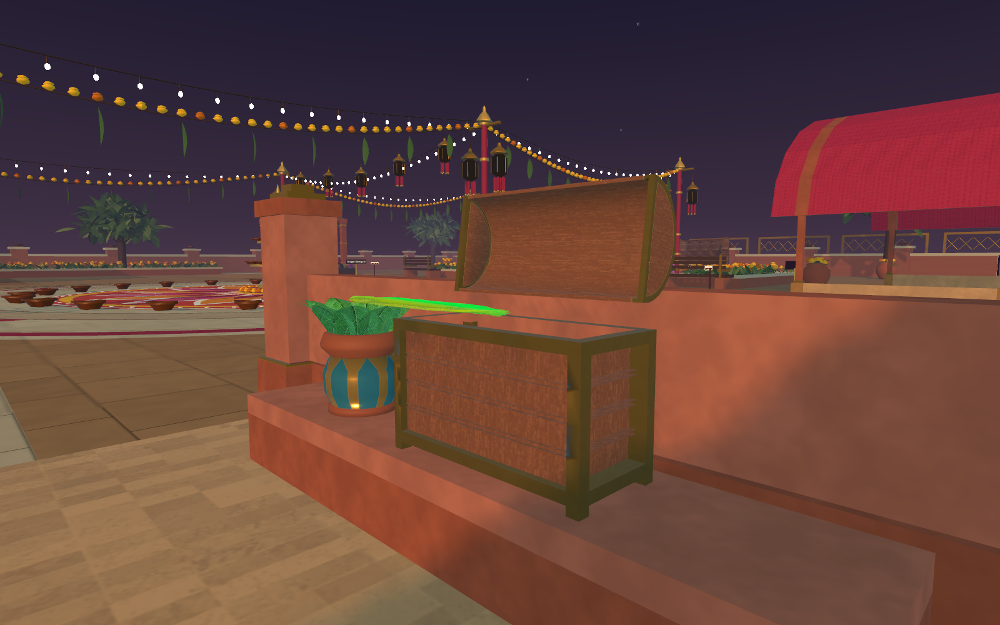

# Sweet, Diya, and rocket staging corrections

- Sweet counter moved 0.5 m inward and 1.8 m along the shop, with its authored basket inset, card, and snap targets kept aligned. A full counter bounds probe reports no penetration against either wall mesh.
- Selected sweets float 0.30 m above the basket interior floor in a spaced layout for swapping. The menu sits to the side, clears the basket sightline, and keeps distance from the player. Confirmation keeps that position; the checkout monitor supplies card feedback.
- Diya menu retains task-based positions and moves outward when the head approaches, keeping the panel edge at least 1.2 m away. The checked cleaning-stage edge clearance was 1.40 m.
- Opening the chest presents the feather at the courtyard-facing front, 0.12 m above the base and 0.12 m clear of its front edge, away from the open lid.
- Any one of the three route tiles now completes the lit-diya carry requirement. Holding, lighting, flame transfer, and final rest remain required.
- Removed the added rocket display stand. The loose rocket rests on the venue floor on startup and restart; the authored adjustable launcher remains.

## Focused verification

Unity desktop Play Mode checks passed for mixed Gujiya/Barfi/Modak floating positions, XR selection of a floating sweet, removal from selection, shelf return within a 0.25 m horizontal/0.15 m vertical margin, unobstructed basket sightline, feather clearance, and menu distance. Visiting tile three first while holding the lit diya advanced to delivery; flame transfer and final release completed all ten Diya actions. Each tile independently passed route logic checks, including held/unlit/duplicate-credit/transfer/reset guards. The rocket ground pose persisted when beginning the activity.

These were targeted desktop checks with synthetic XR selection, not a physical Quest headset session or a full replay of every venue.

