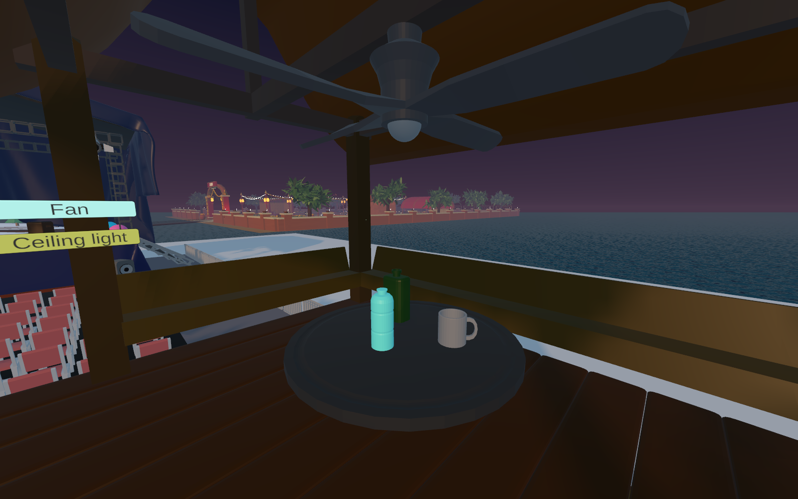
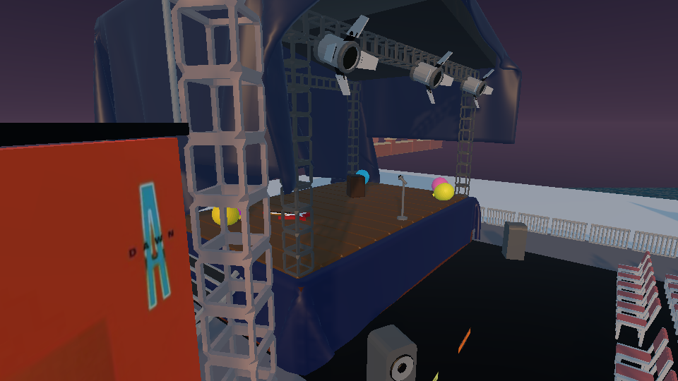
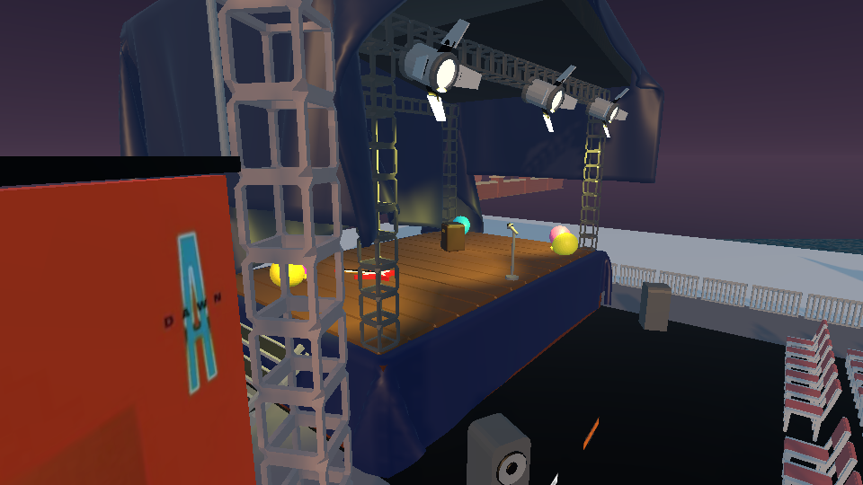

# Geo Island action report

The imported Geo scene contributes **67 distinct source actions**: six world-space button actions and 61 grab-and-place actions. A pickup is counted once, even though the interaction includes grip, carry, release, and settling. Travel is verified separately. The integrated scene is [`DiwaliFestivalGround.unity`](../Assets/Scenes/DiwaliFestivalGround.unity), and the source assets remain under [`Assets/GeoIsland/Source`](../Assets/GeoIsland/Source).

## Six world-space buttons

| ID | Button | Integrated hierarchy path | Result |
|---|---|---|---|
| GEO-UI-01 | Spin display | `Geo Island Integration/gg/Canvas/Button` | **Passed.** Starts/stops the `Cube.105` display rotation. |
| GEO-UI-02 | Fan | `Geo Island Integration/gg/Canvas (1)/Button` | **Passed.** Starts/stops `Cylinder.005` around its vertical shaft (configured local Z). |
| GEO-UI-03 | Ceiling light | `Geo Island Integration/gg/Canvas (1)/Button (1)` | **Passed.** Turns the linked ceiling light on/off. |
| GEO-UI-04 | Shop light | `Geo Island Integration/gg/Canvas (2)/Button (1)` | **Passed.** Turns the shop point light and visible glow on/off. |
| GEO-UI-05 | Stage lights | `Geo Island Integration/gg/Canvas (3)/Button (1)` | **Passed.** Lights the stage with all three spotlights; lamp lenses visibly switch off/on. |
| GEO-UI-06 | Play / pause music | `Geo Island Integration/gg/Canvas (4)/Button (1)` | **Passed.** Plays/pauses the local 3D audio source. |

All six buttons passed standing XR ray reach, queued press dispatch, target response, and a second press to restore the initial state. The fan test checked its shaft and pivot; the light tests checked actual light and glow states; the music test checked playback and spatial settings. The imported stage button had targeted a ceiling light, and the shop button had omitted its point light; the integrated mappings now cover all three stage spotlights and the shop light plus glow.

## 61 grab-and-place actions

Every row below passed queued NearFar selection, a short local carry and return, release, scale and collider checks, and settling on its original support. All 61 starting transforms were restored from the imported source scene, and every untouched pose was checked before pickup. Props stay in their authored positions until first grabbed, then use gravity and fitted colliders when released. The mug and both bottles remain on the elevated room table. The room controls are positioned relative to that room floor, rather than the ground below it.

| ID | Imported object | Integrated hierarchy path | Result |
|---|---|---|---|
| GEO-GRAB-01 | `Circle.004` | `Geo Island Integration/gg/Circle.004` | Passed |
| GEO-GRAB-02 | `Circle.005` | `Geo Island Integration/gg/Circle.005` | Passed |
| GEO-GRAB-03 | `Cube` | `Geo Island Integration/gg/Cube` | Passed |
| GEO-GRAB-04 | `Cube.022` | `Geo Island Integration/gg/Cube.022` | Passed |
| GEO-GRAB-05 | `Cube.030` | `Geo Island Integration/gg/Cube.030` | Passed |
| GEO-GRAB-06 | `Cube.031` | `Geo Island Integration/gg/Cube.031` | Passed |
| GEO-GRAB-07 | `Cube.035` | `Geo Island Integration/gg/Cube.035` | Passed |
| GEO-GRAB-08 | `Cube.059` | `Geo Island Integration/gg/Cube.059` | Passed |
| GEO-GRAB-09 | `Cube.088` | `Geo Island Integration/gg/Cube.088` | Passed |
| GEO-GRAB-10 | `Cube.097` | `Geo Island Integration/gg/Cube.097` | Passed |
| GEO-GRAB-11 | `Cube.098` | `Geo Island Integration/gg/Cube.098` | Passed |
| GEO-GRAB-12 | `Cube.099` | `Geo Island Integration/gg/Cube.099` | Passed |
| GEO-GRAB-13 | `Cube.100` | `Geo Island Integration/gg/Cube.100` | Passed |
| GEO-GRAB-14 | `Cube.101` | `Geo Island Integration/gg/Cube.101` | Passed |
| GEO-GRAB-15 | `Cube.105` | `Geo Island Integration/gg/Cube.105` | Passed |
| GEO-GRAB-16 | `Cube.106` | `Geo Island Integration/gg/Cube.106` | Passed |
| GEO-GRAB-17 | `Cylinder` | `Geo Island Integration/gg/Cylinder` | Passed |
| GEO-GRAB-18 | `Cylinder.001` | `Geo Island Integration/gg/Cylinder.001` | Passed |
| GEO-GRAB-19 | `Cylinder.002` | `Geo Island Integration/gg/Cylinder.002` | Passed |
| GEO-GRAB-20 | `Cylinder.003` | `Geo Island Integration/gg/Cylinder.003` | Passed |
| GEO-GRAB-21 | `Cylinder.004` | `Geo Island Integration/gg/Cylinder.004` | Passed |
| GEO-GRAB-22 | `Cylinder.007` | `Geo Island Integration/gg/Cylinder.007` | Passed |
| GEO-GRAB-23 | `Cylinder.009` | `Geo Island Integration/gg/Cylinder.009` | Passed |
| GEO-GRAB-24 | `Cylinder.010` | `Geo Island Integration/gg/Cylinder.010` | Passed |
| GEO-GRAB-25 | `Cylinder.011` | `Geo Island Integration/gg/Cylinder.011` | Passed |
| GEO-GRAB-26 | `Cylinder.012` | `Geo Island Integration/gg/Cylinder.012` | Passed |
| GEO-GRAB-27 | `Cylinder.013` | `Geo Island Integration/gg/Cylinder.013` | Passed |
| GEO-GRAB-28 | `Cylinder.014` | `Geo Island Integration/gg/Cylinder.014` | Passed |
| GEO-GRAB-29 | `Cylinder.015` | `Geo Island Integration/gg/Cylinder.015` | Passed |
| GEO-GRAB-30 | `Cylinder.016` | `Geo Island Integration/gg/Cylinder.016` | Passed |
| GEO-GRAB-31 | `Cylinder.017` | `Geo Island Integration/gg/Cylinder.017` | Passed |
| GEO-GRAB-32 | `Cylinder.018` | `Geo Island Integration/gg/Cylinder.018` | Passed |
| GEO-GRAB-33 | `Cylinder.019` | `Geo Island Integration/gg/Cylinder.019` | Passed |
| GEO-GRAB-34 | `Cylinder.020` | `Geo Island Integration/gg/Cylinder.020` | Passed |
| GEO-GRAB-35 | `Cylinder.023` | `Geo Island Integration/gg/Cylinder.023` | Passed |
| GEO-GRAB-36 | `Cylinder.024` | `Geo Island Integration/gg/Cylinder.024` | Passed |
| GEO-GRAB-37 | `Cylinder.025` | `Geo Island Integration/gg/Cylinder.025` | Passed |
| GEO-GRAB-38 | `Cylinder.030` | `Geo Island Integration/gg/Cylinder.030` | Passed |
| GEO-GRAB-39 | `Cylinder.034` | `Geo Island Integration/gg/Cylinder.034` | Passed |
| GEO-GRAB-40 | `Cylinder.035` | `Geo Island Integration/gg/Cylinder.035` | Passed |
| GEO-GRAB-41 | `Cylinder.036` | `Geo Island Integration/gg/Cylinder.036` | Passed |
| GEO-GRAB-42 | `Cylinder.037` | `Geo Island Integration/gg/Cylinder.037` | Passed |
| GEO-GRAB-43 | `Cylinder.038` | `Geo Island Integration/gg/Cylinder.038` | Passed |
| GEO-GRAB-44 | `Cylinder.039` | `Geo Island Integration/gg/Cylinder.039` | Passed |
| GEO-GRAB-45 | `Cylinder.044` | `Geo Island Integration/gg/Cylinder.044` | Passed |
| GEO-GRAB-46 | `Cylinder.045` | `Geo Island Integration/gg/Cylinder.045` | Passed |
| GEO-GRAB-47 | `Cylinder.046` | `Geo Island Integration/gg/Cylinder.046` | Passed |
| GEO-GRAB-48 | `Cylinder.048` | `Geo Island Integration/gg/Cylinder.048` | Passed |
| GEO-GRAB-49 | `Cylinder.049` | `Geo Island Integration/gg/Cylinder.049` | Passed |
| GEO-GRAB-50 | `Cylinder.050` | `Geo Island Integration/gg/Cylinder.050` | Passed |
| GEO-GRAB-51 | `Cylinder.051` | `Geo Island Integration/gg/Cylinder.051` | Passed |
| GEO-GRAB-52 | `Cylinder.052` | `Geo Island Integration/gg/Cylinder.052` | Passed |
| GEO-GRAB-53 | `Plane.010` | `Geo Island Integration/gg/Plane.010` | Passed |
| GEO-GRAB-54 | `Plane.011` | `Geo Island Integration/gg/Plane.011` | Passed |
| GEO-GRAB-55 | `Plane.012` | `Geo Island Integration/gg/Plane.012` | Passed |
| GEO-GRAB-56 | `Sphere.017` | `Geo Island Integration/gg/Sphere.017` | Passed |
| GEO-GRAB-57 | `Sphere.018` | `Geo Island Integration/gg/Sphere.018` | Passed |
| GEO-GRAB-58 | `Sphere.019` | `Geo Island Integration/gg/Sphere.019` | Passed |
| GEO-GRAB-59 | `Sphere.020` | `Geo Island Integration/gg/Sphere.020` | Passed |
| GEO-GRAB-60 | `Sphere.021` | `Geo Island Integration/gg/Sphere.021` | Passed |
| GEO-GRAB-61 | `Torus` | `Geo Island Integration/gg/Torus` | Passed |

## Table placement and travel

Six main tabletops (`Cube.003`, `Cube.004`, `Cube.045`, `Cube.055`, `Cube.069`, `Cube.077`) each passed two real gravity drops of `Cylinder.020`, from **0.15 m** and **0.75 m** above an unobstructed spot. All 12 drops passed in the current full audit. The elevated room and stage also have mesh-based floor collision and teleport surfaces. An actual CharacterController walk reached the room from ground level using the production player radius, step offset and slope limit, with no ending overlaps. See [`Geo_Room_Stair_Verification.json`](Geo_Room_Stair_Verification.json).
The Geo ground is **69 × 48 m**, with source content enlarged **25%** and moved closer to the other islands (ground center near **X 89, Z −53.5**). A shared Y-shaped cedar bridge branches from Diwali toward Christmas and Geo. The Geo travel option, arrival floor and capsule clearance, Geo kiosk access, and return to Festival Plaza passed the travel suite (**143 checks, 0 failures**). See [`FinalTravelVerification.json`](FinalTravelVerification.json).

## Evidence and scope

The current [`GeoFullInteractionVerification_2026-10-25.json`](GeoFullInteractionVerification_2026-10-25.json) passed **873 checks with 0 failures**, covering all **67 source actions**, unchanged starting poses, visible stage-light output, room-floor reach and all 12 tabletop drops. Stage lighting was tested with rendered before/after images, rather than relying only on Light.enabled state. Music starts silent and its button supports looping playback, pause and resume. Automatic gaze selection is disabled in the player prefab, so looking around cannot click a different menu or interfere with controller input.

These checks used queued XR input and physics in Unity desktop Play mode. They verify the recorded scene behavior, not physical Quest headset comfort or Android performance.
