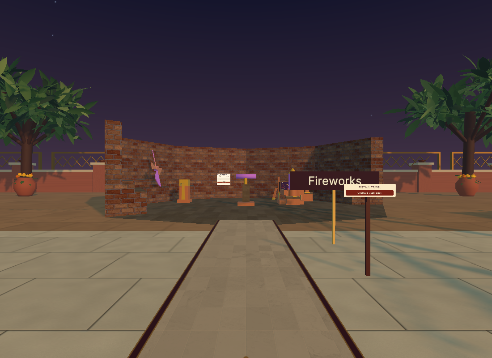
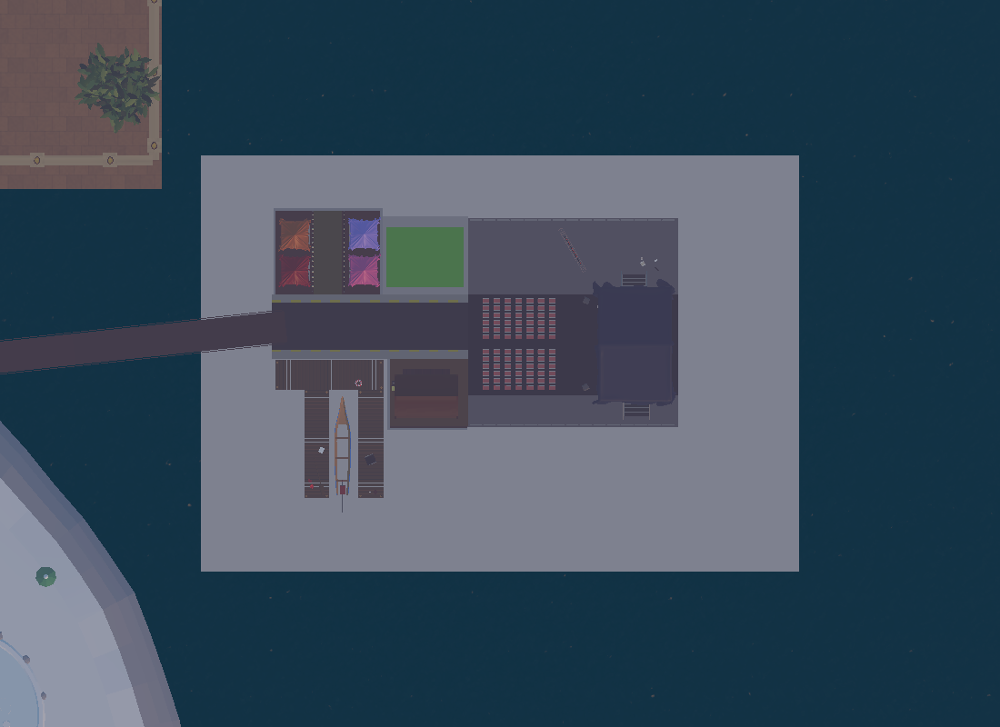
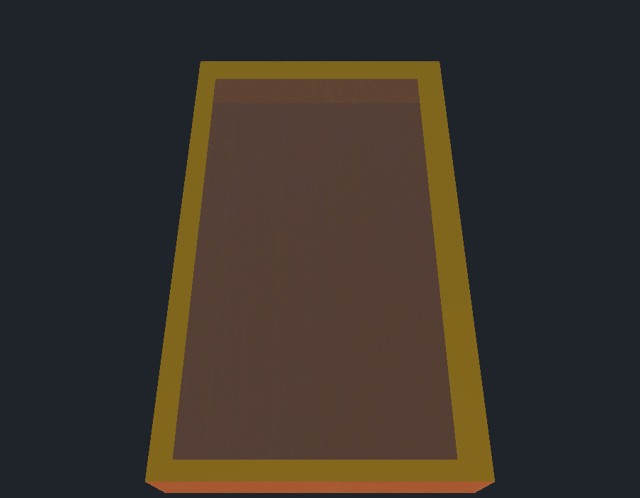

# Movement, fireworks grip, and Geo entrance fixes

## Changes

- Walking overlays now have one upward-facing triangle per visible face and matching physical surfaces. Decorative route inlays no longer act as obstacles. Layered paving does not cast overlapping shadows.
- Fireworks board, rocket tilt, and fountain height use dedicated grip targets. Near grabs follow hand height; far grabs follow the controller ray, so raising the wrist changes the setting without moving the hand. The board can be adjusted before loading the rocket.
- The Geo island faces the bridge through its original front road. The bridge, arrival point, kiosk, and collision support meet that road. All 61 authored local pickup poses are preserved.

- The rocket tray interior uses a dedicated two-sided material, making the existing downward-facing floor visible from inside. Its mesh, UVs, and gold rim remain intact.
- Christmas and Geo kiosks list only Diwali Island, Christmas Island, and Geo Island. Diwali venue kiosks retain individual game destinations.

## Verification

Desktop Unity Play Mode checks passed:

| Check | Result | Evidence |
|---|---:|---|
| Full fireworks workflow, plunger, effects, finale, and reset | 100 passed | [Fireworks_Full_Regression.json](Fireworks_Full_Regression.json) |
| Production left/right NearFarInteractor grip and release | 17 passed | [Production_Grip_After.tsv](Production_Grip_After.tsv) |
| CharacterController movement across paths, ring, bridge, and Geo front road | 96 sections passed | [Walking_Surface_Verification.tsv](Walking_Surface_Verification.tsv) |
| All eight travel destinations and venue approaches | 143 passed | [Travel_Regression.json](Travel_Regression.json) |
| Geo authored pickup poses after whole-island rotation | 61 preserved | [Geo_Front_Entry_Pose_Verification.json](Geo_Front_Entry_Pose_Verification.json) |
| Geo room stairs after rotation | Passed | [Geo_Rotated_Stair_Walk.tsv](Geo_Rotated_Stair_Walk.tsv) |

Grip verification used both existing production controller components and checked near hand movement and far wrist-only aiming. These checks do not substitute for a physical Quest headset session.

The final tray and island-menu check verified six destination labels, correct arrivals in both tested travel directions, and a rendered view of the repaired tray floor. See [Tray_Island_Menu_Verification.json](Tray_Island_Menu_Verification.json).

